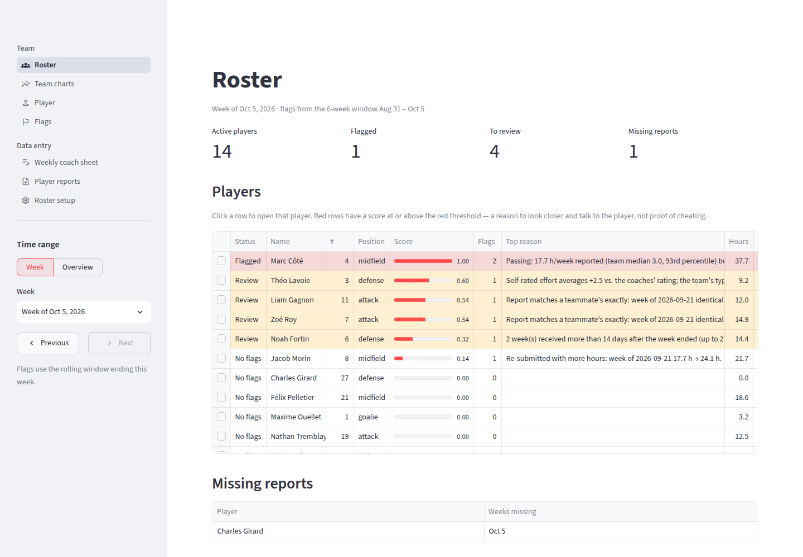
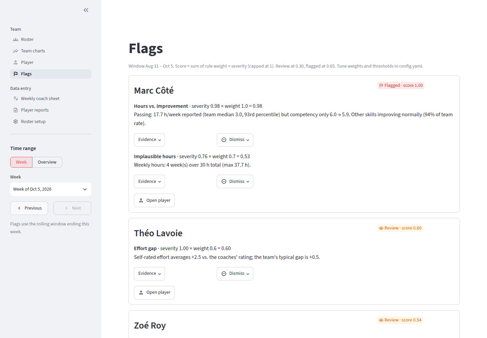
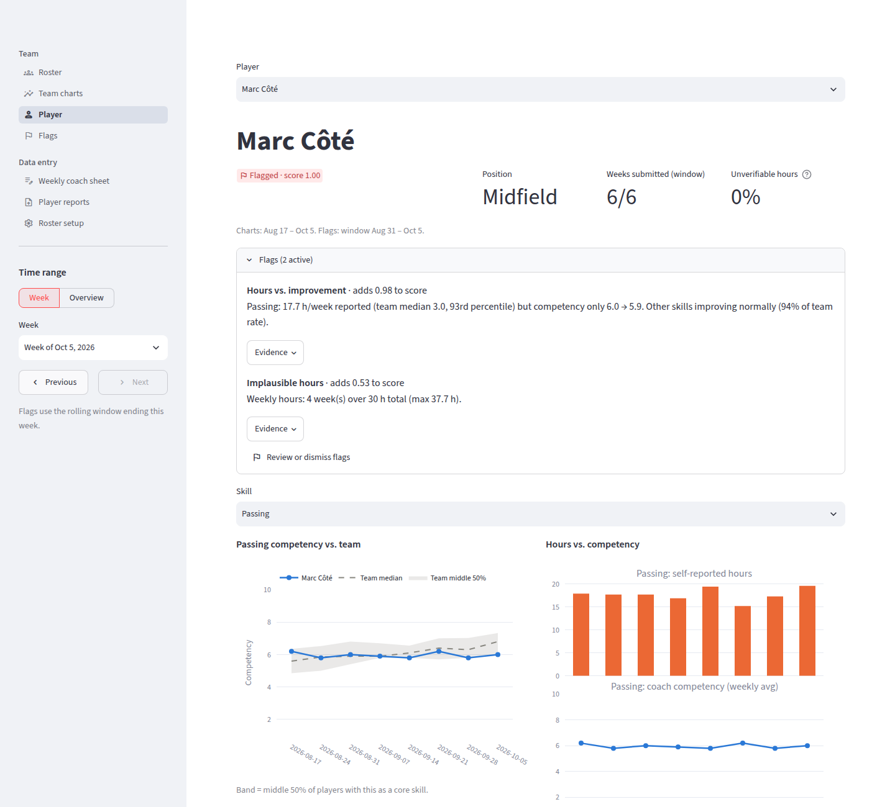
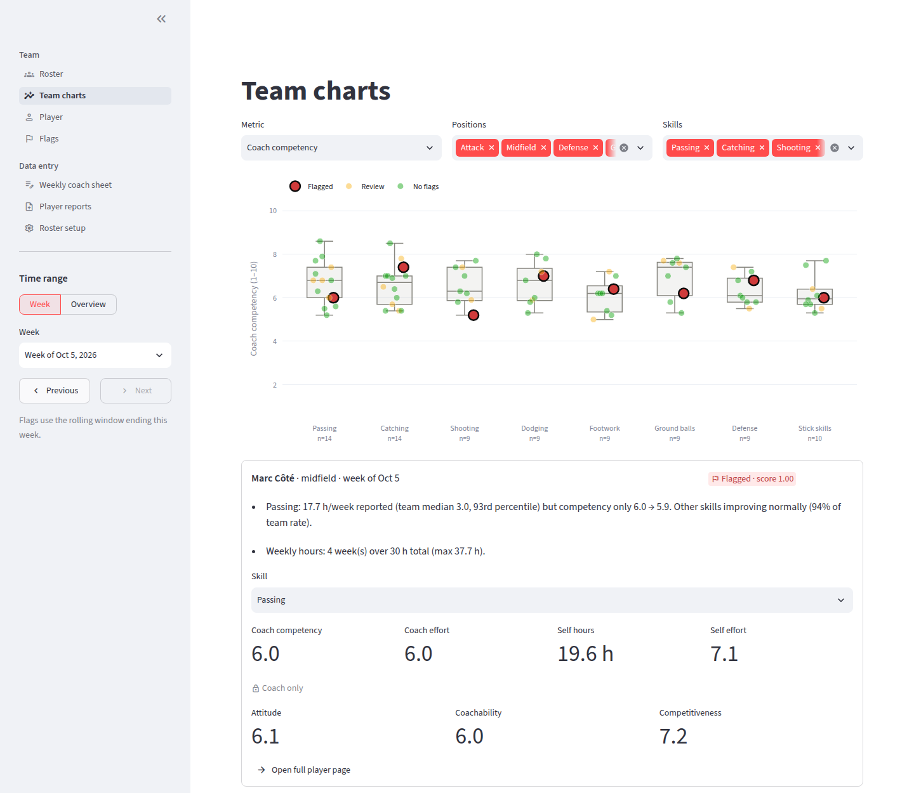
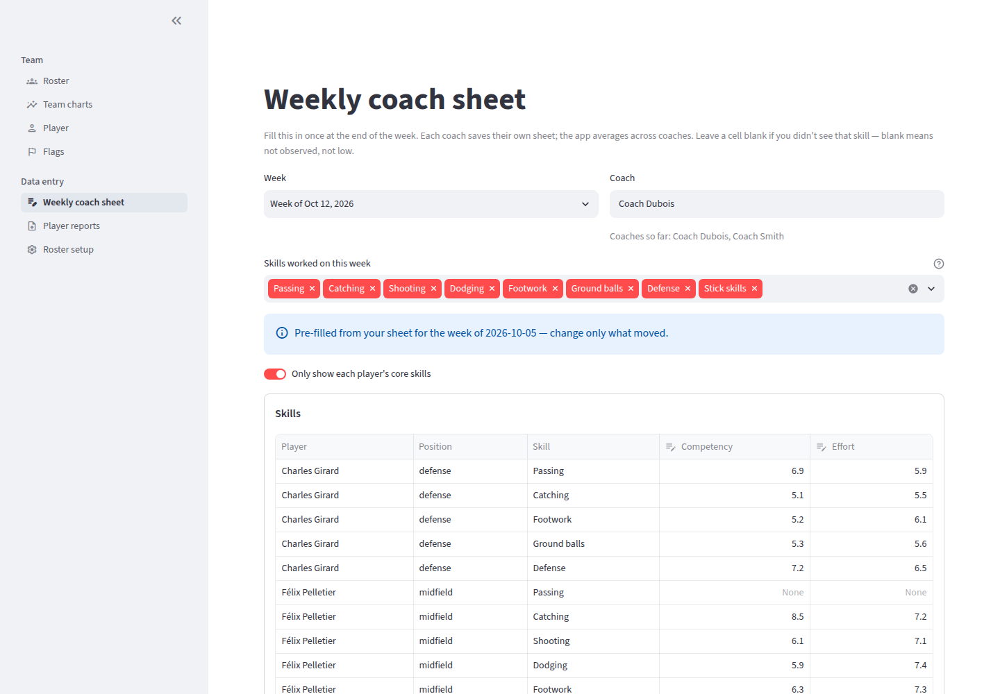

# Lacrosse Tracker

A local, single-user app for tracking lacrosse player development across a season.

Coaches fill in a weekly sheet rating each player. Players send a weekly CSV of their own training.
The app cross-checks the two, charts each player's progression against the team, and flags players
whose self-reports don't line up with what the coaches see.

Everything runs on your own machine with Streamlit and SQLite. There are no accounts, no server and no
cloud service.

**Version 1.1.0** · Python · Streamlit · SQLite · pandas · Plotly · pytest · [MIT licence](LICENSE)



---

## Contents

- [Why it exists](#why-it-exists)
- [Features](#features)
- [Screenshots](#screenshots)
- [Quick start](#quick-start)
- [How it fits together](#how-it-fits-together)
- [Project structure](#project-structure)
- [Weekly workflow](#weekly-workflow)
- [Pages](#pages)
- [Cheat detection](#cheat-detection)
- [Traceability](#traceability)
- [Configuration](#configuration)
- [Testing](#testing)
- [Backups](#backups)
- [Version history](#version-history)
- [Licence](#licence)

## Why it exists

Players are asked to log their training between practices, but self-reported hours are easy to inflate
and impossible to prove false. What a coach *can* see is whether a skill is actually improving. This app
puts those two sources side by side. A player reporting 18 hours a week of passing while their passing
rating stays flat is worth a conversation.

The app is deliberately cautious. It never accuses anyone. Every flag comes with the numbers behind it
and is framed as *a reason to review*, not a verdict.

## Features

- **Weekly coach sheet.** Coaches rate competency and effort for each player and skill. The sheet
  pre-fills from the previous week, so only changes need typing. Ratings from several coaches are
  averaged.
- **Validated CSV import.** Each player's weekly report is checked row by row. A file with any error
  is rejected whole, with a plain-English reason for every problem.
- **Seven detection rules** look for hours that don't match improvement, inflated self-rated effort,
  implausible totals, copied reports, too-perfect data, late backfilling and edited resubmissions.
- **Interactive team charts.** Box plots show every player as a clickable dot. There's also a skills
  heatmap, an hours-vs-improvement scatter and an effort-gap chart.
- **Per-player page** with trends against the team's middle-50% band and the source row behind every
  number.
- **Full audit trail.** Original files are archived untouched and hashed. Nothing in the database is
  ever overwritten.
- **Config-driven.** Skills, positions, coach-only traits and every detection threshold live in one
  YAML file.

## Screenshots

All screenshots use the bundled demo season (`python scripts/make_demo.py --fresh`). Every name in it
is fictional.

**Flags.** Each flag shows the rule that fired, how much it adds to the score, and the numbers behind it.
Flags can be dismissed with a note.



**Player.** This is the planted hours-vs-improvement case. The player reports about 18 hours a week of
passing, but their passing competency stays flat while the team's median rises.



**Team charts.** Every player is a dot on top of the team's box plot, coloured by status. Clicking a dot
opens that player in the panel below.



**Weekly coach sheet.** The sheet pre-fills from the coach's previous week, so only changes need typing.



## Quick start

Requires Python 3.10 or newer.

```bash
python -m venv .venv && source .venv/bin/activate
pip install -r requirements.txt
python scripts/make_demo.py --fresh     # optional: a fake 8-week season with planted cheaters
streamlit run app.py                    # opens http://localhost:8501
```

The demo season contains 14 fictional players and two coaches. It includes one planted case for each
of the main detection rules, so you can see flags fire straight away. The planted cases are listed at
the top of [`scripts/make_demo.py`](scripts/make_demo.py).

To start for real, skip the demo (or delete the `data/` folder) and add players on **Roster setup**.

## How it fits together

```
 Player CSVs ──► data/inbox/ ──► validate ──► data/archive/   (original kept, named by hash)
                                    │    └──► data/rejected/  (+ .errors.txt explaining why)
 Weekly coach sheet ───────────────►│
                                    ▼
                             data/tracker.db  ◄── detection (recomputed live for any week)
                                    │
                                    ▼
           Roster · Team charts · Player · Flags   (week view or overview)
```

The code is split into a UI-free core package (`tracker/`) and thin Streamlit pages (`views/`). All
database reads go through `tracker/queries.py` and come back as pandas DataFrames. The detection rules
are plain functions over those DataFrames, so they can be tested without Streamlit.

## Project structure

| Path | What it is |
|---|---|
| [`app.py`](app.py) | Streamlit entry point and page list |
| [`config.yaml`](config.yaml) | Skills, coach-only traits, positions and their core skills, detection weights and thresholds |
| [`tracker/config.py`](tracker/config.py) | Loads `config.yaml` into a frozen `Config` object |
| [`tracker/db.py`](tracker/db.py) | SQLite schema and connection |
| [`tracker/roster.py`](tracker/roster.py) | Adding and editing players, submit codes |
| [`tracker/ingest.py`](tracker/ingest.py) | CSV validation and import |
| [`tracker/coach.py`](tracker/coach.py) | Saving and pre-filling the weekly coach sheet |
| [`tracker/queries.py`](tracker/queries.py) | Read-side queries returning DataFrames |
| [`tracker/detection.py`](tracker/detection.py) | Cheat-detection rules and scoring |
| [`tracker/charts.py`](tracker/charts.py) | Plotly figures |
| [`tracker/ui.py`](tracker/ui.py) | Streamlit helpers shared by every page (week picker, status badges) |
| [`views/`](views/) | One file per page |
| [`scripts/make_demo.py`](scripts/make_demo.py) | Demo season generator |
| [`tests/`](tests/) | pytest suite |

Every source file begins with a header that describes the file and lists its version history.

## Weekly workflow

1. **Players** send one CSV per week. A template is on the **Player reports** page.

   ```
   submit_code,week_start,skill,hours,effort
   K7Q2,2026-10-05,passing,6.0,7.5
   K7Q2,2026-10-05,shooting,0,
   ```

   - `submit_code` is the player's 4-character code from **Roster setup**. It isn't a password, just
     a guard against submitting under a teammate's name.
   - `week_start` is that week's Monday, and can't be in the future.
   - `hours = 0` means "didn't train it". Effort on that row is ignored.
   - `hours > 0` needs an effort from 1.0 to 10.0, with one decimal place.
   - A skill with no row is recorded as 0 hours, with a warning.
   - One file can hold several weeks, but only one player.
2. **You** drop the files on **Player reports**, or copy them into `data/inbox/` and click
   *Import inbox*. A file with any error is rejected whole, with the reason.
3. **Each coach** fills in the **Weekly coach sheet**. It covers competency and effort per skill, plus
   attitude, coachability and competitiveness. It pre-fills from that coach's previous week, so you
   only change what moved. A blank cell means "not observed", never a low score. Ratings from several
   coaches are averaged.
4. Check **Roster** and **Flags**.

A corrected report for the same week replaces the earlier one. Both are kept in the history.
Re-sending a byte-identical file is refused as a duplicate.

## Pages

The sidebar switches between **Week**, which shows one week's snapshot with ‹ › arrows, and
**Overview**, which shows a range of weeks as trends. The choice carries across pages.

| Page | What it shows |
|---|---|
| **Roster** | Every player with status colour, score, top reason, hours, report status and the share of hours the coaches can't verify. Red rows are flagged. Click a row to open the player. |
| **Team charts** | Box plots with every player as a dot. Click a dot to open that player in the panel below. Metrics: coach competency, coach effort, self-reported hours, self-rated effort, total hours (split by position in week view) and coach-only traits. Tabs hold a players × skills heatmap, an hours-vs-improvement scatter and an effort-gap dumbbell chart. |
| **Player** | Competency against the team's middle-50% band, hours vs. competency, self vs. coach effort, coach-only traits, and hours by skill (unverifiable hours in gray). Also the source rows behind every number: file, CSV row, received time and superseded versions. |
| **Flags** | Every active flag with its evidence. Dismiss a flag with a note, or restore it. |
| **Weekly coach sheet** | The coach's rating grid for one week. |
| **Player reports** | Upload, the CSV template, and a log of every file received. |
| **Roster setup** | Add and edit players, issue new submit codes, download all codes. |

On the Team charts page, zeros are hidden from hours boxes by default. A toggle brings them back, and
a note says how many are hidden.

## Cheat detection

Each rule gives a severity from 0 to 1. A player's score is `sum(weight × severity)`, capped at 1, over a
rolling window (6 weeks by default) ending at the selected week. A score of 0.30 puts a player under
review, and 0.65 flags them. All of these numbers live in `config.yaml`.

| Rule | Fires when | Weight |
|---|---|---|
| Hours vs. improvement | Hours on a skill are well above the team median (≥4 h/week), while coach competency for that skill is flat compared with teammates who have it as a core skill. Severity is halved if *all* the player's skills are flat, because that looks more like a plateau or a rating issue. | 1.0 |
| Effort gap | Self-rated effort minus coach effort is far above the team's typical gap (robust z > 2.5 and > 1.0 above the median). | 0.6 |
| Implausible hours | The weekly total is over 30 h, or jumps suddenly to 2.5× the player's usual. | 0.7 |
| Copied report | A week's report is identical to a teammate's. Both players are flagged, since you can't tell who copied. | 0.9 |
| Too-perfect data | The same effort on every row, nearly all 10.0s, or identical hours every week. | 0.5 |
| Late / backfilled | A week was received more than 14 days late, or 3+ weeks came in one file. | 0.4 |
| Edited resubmission | A week was re-sent with ≥20% and ≥3 more hours. | 0.4 |

How improvement is measured: for each player and skill, the app fits a straight line through the
coaches' weekly competency ratings. It divides the slope by the room left to improve, so a player
already at 9.0 isn't expected to gain as fast as one at 4.0. That normalised rate is then compared
with the median of teammates who have the skill as a core skill.

Design choices:

- **Off-profile skills**, like a defender practising shooting, are allowed. They're compared against
  players who have that skill as core, and never penalised.
- **Unverifiable hours** are hours in skills no coach rated in the window. They're shown as a hint,
  not scored.
- **Coach-only traits are never used in detection**, so a low coachability rating can't make a player
  look like a cheater.
- **Missing reports are shown, not scored.** Players need 3 submitted weeks before they're judged.
  Until then they show as gray, "Not enough data".
- **Robust statistics.** The effort-gap rule uses the median and median absolute deviation instead of
  the mean and standard deviation, so one extreme player can't hide another.
- **Detection is computed live**, so changing a weight or threshold takes effect on the next page load.
  A dismissal applies to one rule, player and window.

A red status means *have a conversation*, not *proven cheating*.

## Traceability

- **Raw files are never modified.** Every imported file is stored in `data/archive/` with its SHA-256.
  Every training row records its file and CSV row number.
- **Nothing is overwritten.** A resubmitted week or a corrected coach rating inserts a new row and marks
  the old one superseded. The history is visible on the Player page.
- **Scores are stored as integer tenths**, so 7.5 is saved as 75. The database itself enforces the
  1.0–10.0 scale with `CHECK` constraints.
- **Imports are atomic.** A file is imported in a single transaction, so it either lands completely or
  not at all.

## Configuration

Everything team-specific is in [`config.yaml`](config.yaml). No code changes are needed to:

- rename or add skills (`skills`)
- change which skills are core for each position (`positions`)
- add or remove coach-only traits (`coach_traits`)
- tune the rolling window, minimum data requirements, rule weights and thresholds (`detection`)

Two environment variables override paths. `TRACKER_CONFIG` points at a different YAML file, and
`TRACKER_DATA_DIR` points at a different data folder.

## Testing

```bash
python -m pytest
```

The suite covers CSV validation (every rejection reason), filling in missing skills, duplicate and
superseding imports, coach-sheet averaging and history, and an end-to-end check of the
hours-vs-improvement rule. Tests run against an in-memory database and a throwaway data folder, so
they never touch `data/`.

## Backups

Copy the whole `data/` folder. `tracker.db` plus `archive/` is everything.

## Version history

| Version | Date | Changes |
|---|---|---|
| 1.1.0 | 2026-10-15 | Readability pass: descriptive variable names throughout, a header with version history on every file. Expanded README with screenshots, and an MIT licence. No change in behaviour. |
| 1.0.0 | 2026-10-13 | Initial release. |

## Licence

Released under the [MIT licence](LICENSE). You're free to use, copy, modify and distribute the code,
including commercially, as long as the licence notice stays with it.
